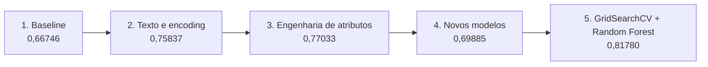

# Previsão de Sobrevivência no Titanic

Evolução de cinco abordagens de machine learning para a [competição Titanic do Kaggle](https://www.kaggle.com/competitions/titanic/overview), partindo de um baseline simples até alcançar `0,81780` no leaderboard público.

## Evolução dos resultados

| Etapa | Principal mudança | Score público Kaggle |
| ---: | --- | ---: |
| 1 | Limpeza inicial e comparação entre árvore de decisão, KNN e regressão logística | 0,66746 |
| 2 | Tratamento das variáveis de texto com transformação e One-Hot Encoding | 0,75837 |
| 3 | Engenharia de atributos, ajuste de escala e análise de correlação | 0,77033 |
| 4 | Inclusão de Random Forest e MLPClassifier | 0,69885 |
| 5 | Otimização de hiperparâmetros com GridSearchCV e seleção da Random Forest | **0,81780** |

O ganho entre a primeira e a melhor submissão foi de aproximadamente 15 pontos percentuais.



## Objetivo

O projeto investiga como decisões de preparação dos dados, engenharia de atributos, seleção de algoritmos e ajuste de hiperparâmetros afetam um problema de classificação binária.

Além do score final, os notebooks registram tentativas que pioraram o resultado. A quarta etapa, por exemplo, apresentou melhor desempenho local com MLPClassifier, mas uma queda no leaderboard, indicando possível overfitting.

## Notebooks

| Etapa | Notebook | Conteúdo |
| ---: | --- | --- |
| 1 | [`1-titanic.ipynb`](1-titanic.ipynb) | Inspeção, limpeza inicial e primeiros modelos |
| 2 | [`2-attempt-titanic.ipynb`](2-attempt-titanic.ipynb) | Tratamento das variáveis categóricas |
| 3 | [`3-attempt-titanic.ipynb`](3-attempt-titanic.ipynb) | Escala, atributos familiares e seleção de variáveis |
| 4 | [`4-attempt-titanic.ipynb`](4-attempt-titanic.ipynb) | Random Forest, rede neural e análise de overfitting |
| 5 | [`5-attempt-titanic.ipynb`](5-attempt-titanic.ipynb) | GridSearchCV e escolha do melhor modelo |

O relatório exploratório gerado com ydata-profiling está em [`titanic_statistic_ydata.html`](titanic_statistic_ydata.html).

## Metodologia aplicada

- Tratamento de valores ausentes com medidas de tendência central.
- Transformação de variáveis categóricas.
- Engenharia de atributos a partir de relações familiares e condição de viagem.
- Ajuste de escala para idade e tarifa.
- Comparação entre regressão logística, KNN, árvore de decisão, Random Forest e MLPClassifier.
- Otimização de hiperparâmetros com GridSearchCV.
- Avaliação local por acurácia e matriz de confusão, acompanhada do score público do Kaggle.

## Como reproduzir

1. Baixe os arquivos da competição no Kaggle.
2. Ajuste os caminhos de entrada indicados nos notebooks.
3. Instale Jupyter e as bibliotecas utilizadas.
4. Execute os notebooks na ordem numérica.

Bibliotecas principais:

```bash
pip install jupyter pandas numpy matplotlib seaborn scikit-learn ydata-profiling
jupyter notebook
```

## Interpretação dos resultados

O score público do Kaggle é útil para acompanhar as submissões, mas não substitui uma estratégia de validação local. Comparações futuras devem registrar explicitamente a divisão entre treino e validação, a semente aleatória, a validação cruzada e o pipeline de pré-processamento.

## Próximos passos

- Consolidar preparação e modelo em um `Pipeline` do scikit-learn.
- Fixar sementes e registrar métricas de validação cruzada.
- Adicionar Precision, Recall, F1 e ROC AUC à comparação local.
- Analisar erros do melhor modelo por grupos de passageiros.
- Criar um arquivo de dependências para reprodução do ambiente.

